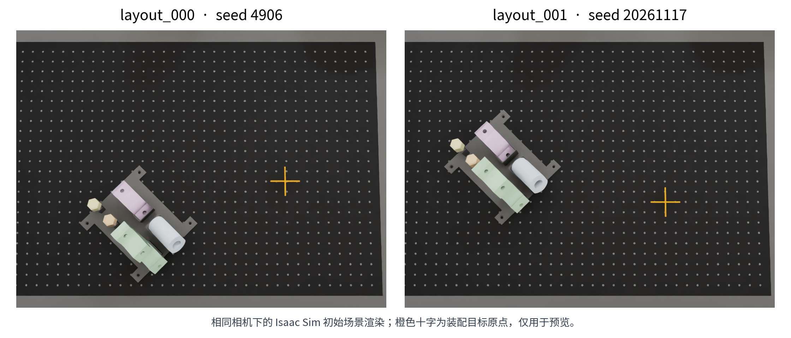

# plumbers_block 固定布局：layout_000 与 layout_001

`layout_000` 对应上一次完整成功的原始摆放，`layout_001` 对应本次完整成功的新摆放。两者已经登记为同一 recipe 的固定 profile，不新增重复的任务目录。

- 配置：[recipe.yaml](../roboassemblybench/tasks/fabrica_plumbers_block_ur5e_staged/recipe.yaml)。
- 坐标、初始零件位姿与验证来源：[layouts.json](../roboassemblybench/tasks/fabrica_plumbers_block_ur5e_staged/layouts.json)。
- 运行入口：`fabrica_plumbers_block_ur5e_staged@layout_000` 和 `fabrica_plumbers_block_ur5e_staged@layout_001`。

## 布局可视化



图片由 Isaac Sim 使用相同相机重新渲染。夹具和五个零件的初始位置、四元数以及绿色底座的装配目标，已经逐项与对应成功运行的 `episode_0000.json` 核对，位置差异在数值精度内。预览不推进物理仿真，橙色十字仅标识绿色底座的装配目标原点；正式采集不创建该标记，也不使用预览相机替换三路采集相机。

`layout_001` 将取料夹具及夹具内五个零件整体移向图中左上方，将装配目标移向右下方。夹具与零件之间的相对摆放、45° 取料组朝向、桌板、机器人基座、装配关系和零件尺寸保持一致。取料区和装配区一起改变位置，不能只修改可见夹具而留下旧的抓取或插入目标。

| 坐标项，单位 m | layout_000 | layout_001 |
| --- | --- | --- |
| 成功记录的 seed / layout seed | 4906 / 4906 | 20261117 / 20261117 |
| 取料 CAD 放置原点，场景坐标 | `[0.350, -0.480, 0.0125]` | `[0.289, -0.342, 0.0125]` |
| 夹具 USD prim 原点，世界坐标 | `[0.4914213562, -0.4214213562, 1.0025]` | `[0.4304213562, -0.2834213562, 1.0025]` |
| 底座装配目标原点，场景坐标 | `[0.700, -0.180, 0.0125]` | `[0.680, -0.230, 0.0125]` |
| 底座装配目标原点，世界坐标 | `[0.700, -0.180, 1.0025]` | `[0.680, -0.230, 1.0025]` |
| 取料组绕世界 Z 轴旋转 | 45° | 45° |
| 两个位置采样组的额外平移范围 | 全部为 0 | 全部为 0 |

从 `layout_000` 到 `layout_001`，取料组平移为 `[-0.061, +0.138, 0] m`，平面距离约 150.9 mm；装配目标平移为 `[-0.020, -0.050, 0] m`，平面距离约 53.9 mm。

场景放置原点经桌面场景变换后，世界 Z 增加 0.99 m。取料 CAD 原点是构造整组摆放的基准，**不是夹具 USD prim 原点，也不是夹具网格中心**。核对实际物体时应使用 `sampled_position` / `sampled_orientation`，核对装配目标时使用 `part_2_assembled`。

## 成功记录及适用范围

| 验证项 | layout_000 | layout_001 |
| --- | --- | --- |
| 原始 recipe | `@rl`，几何随机化关闭 | `@rl_marked_layout`，位置范围为 0 |
| 本地完整运行目录 | `outputs/plumbers_limited_release_full_20261110_142548/` | `outputs/plumbers_readonly_full_20261114_211956/` |
| 起点 | 正常初始化，从头运行 | 正常初始化，从头运行 |
| 任务结果 | `success: true` | `success: true` |
| 阶段数 / 物理步数 | 105 / 64,130 | 105 / 64,279 |
| 实际耗时 | 约 60.32 分钟 | 约 66.18 分钟 |
| 三路视频时长 | 267.2 秒 | 267.8 秒 |
| 白件、紫件及两销装配和释放 | 通过 | 通过 |
| 右臂释放、双臂 home、最终无夹持稳定检查 | 通过 | 通过 |

两次运行使用不同版本的控制代码，不能用上表直接比较布局的速度或成功率。`layout_000` 的完整成功属于历史版本；新增固定入口已经核对初始摆放，但尚未用本次代码重新完成该布局全流程。`layout_001` 已由本次只读链接修复后的生产代码完整跑通，编号入口与当次入口的几何、控制参数和阶段图相同，仅增加名称与登记信息。旧入口 `@rl`、`@rl_marked_layout` 保留。

这里的“成功”沿用当前验收条件：白件释放后位置误差 15 mm、总转角 50°；两销释放后轴倾斜不超过 5°，不限制绕自身轴自转。单布局的一次成功不能代替随机布局成功率测试。本次三段 RL 的手腕接触力矩记录均为 0，测力有效性仍需单独验证。

**不要直接使用旧的 seed 4906 随机预览图代替 layout_000。** `outputs/plumbers_new_layout_20261112_175812/layout_4906_top.png` 当时开启了位置随机化，其装配原点约为 `[0.706956, -0.241157, 1.0025]`，与成功运行的 `[0.700, -0.180, 1.0025]` 不同。布局编号绑定明确坐标和配置，seed 数字本身不能唯一描述布局。

## 复现与采集

准备 Isaac Sim 运行环境、桌面场景资产和三个现有 RL 权重后，使用项目验证器。以下两组入口从正常初始化执行完整装配，并录制三路视频：

```bash
# layout_000：原始固定摆放
python roboassemblybench/scripts/validate_fabrica_canonical_ur5e.py \
  --tasks fabrica_plumbers_block_ur5e_staged@layout_000 \
  --seed 4906 --layout-seed 4906 \
  --scene-profile taoyuan_grscenes_tabletop --conda-env internutopia311 \
  --record-live-video --live-video-fps 10 --live-video-frame-stride 24 \
  --live-video-encoder stream \
  --output-dir "outputs/plumbers_layout_000_$(date +%Y%m%d_%H%M%S)"

# layout_001：新固定摆放
python roboassemblybench/scripts/validate_fabrica_canonical_ur5e.py \
  --tasks fabrica_plumbers_block_ur5e_staged@layout_001 \
  --seed 20261117 --layout-seed 20261117 \
  --scene-profile taoyuan_grscenes_tabletop --conda-env internutopia311 \
  --record-live-video --live-video-fps 10 --live-video-frame-stride 24 \
  --live-video-encoder stream \
  --output-dir "outputs/plumbers_layout_001_$(date +%Y%m%d_%H%M%S)"
```

环境名按部署修改，例如 92 上使用 `robo-assembly`。两套固定 profile 将取料区与装配区的额外平移范围置零；变更 episode seed 不会再采样新的位置。`metadata.layout_id` 会进入 episode 的 `task_metadata`，可用于追踪采集布局。仅凭相同固定布局，不能承诺不同 seed 的轨迹一定不同。

批量采集分别选择对应的 `--recipe` 和 `--layout-seeds`，并使用不同输出目录；后台 LeRobot v3 的配置见 [直接写入 v3](direct_lerobot_v3_collection.md)。本次只更新本机代码和 GitHub，不更改 92 上正在运行的采集任务。

## 本次随代码提交的修复

相对于 `9ce8cd9`，本次除固定布局登记外，还包含此前工作区已验证的以下改动：

| 问题 | 修复与代码入口 |
| --- | --- |
| 读取手指或手掌位姿时，临时创建刚体包装会写入 USD，扰动另一只手的接触状态 | `robot_link_pose.py` 读取已有物理视图；任务类缓存只读读取器，运行时不再因位姿查询构造 `SingleRigidPrim` |
| 紫绿总夹力合格，但绿件相对紫件持续漂移 | `support_precision.py` 按固定参考点检查累计漂移和实际孔位，保留每物体双侧接触与精度恢复保护 |
| 预防补夹目标 7 N 与合计夹力软限相互竞争，误触发恢复超时 | `physical_hold_force.py` 区分预防补夹和必需恢复，软限使用滞回；接触、夹持与精度合格时不因预防目标未达成而反复暂停 |
| 报警阈值改变拟合策略，或者受力后有效夹持也无法卸载 | `axis_alignment.py` / `bore_fit.py` 分开实际间隙、minimax 拟合和报警阈值；`torque_relief.py` 允许有效双侧接触下的受限卸载，保留送入门槛、行程与硬限 |
| 仿真采集后还需重复编码、转换 v3 | `datasets/lerobot_v3.py` 使用独立后台写入进程，RGB、深度、状态、力及标注同步落盘；写入失败不计入成功数据 |

本次新布局完整运行中，支撑绿件的最大累计漂移为 0.179 mm，低于 0.25 mm 限值；最大孔位参考点误差约 0.234 mm，低于 0.35 mm 限值。两销都通过 RL 夹持就位、释放、撤离及最终稳定检查。完整运行未使用中途快照恢复、临时初始化补丁或运行中阈值覆盖。

历史控制修复说明见 [读取、整轴对齐与释放修复](plumbers_block_readback_shaft_release_fixes.md)，本次的接触、支撑与卸载参数见 [RL 核心说明](../roboassemblybench/core/rl/README.md)。视频、原始完整运行报告、权重和 `/tests/` 的本地改动不随本次提交上传；本文布局图与坐标登记随代码保留。

提交前在本机保留的测试集上运行 751 项回归并通过：夹持、支撑、只读测量、recipe 与采集管理 579 项，RL 核心 166 项，独立 LeRobot 环境中的后台 v3 写入 6 项。两套固定入口还通过了与历史成功记录逐件位姿一致、布局编号元数据及阶段图一致性检查。格式、YAML、密钥和 Git diff 检查通过；这些单元与配置检查不替代新的完整物理仿真。
